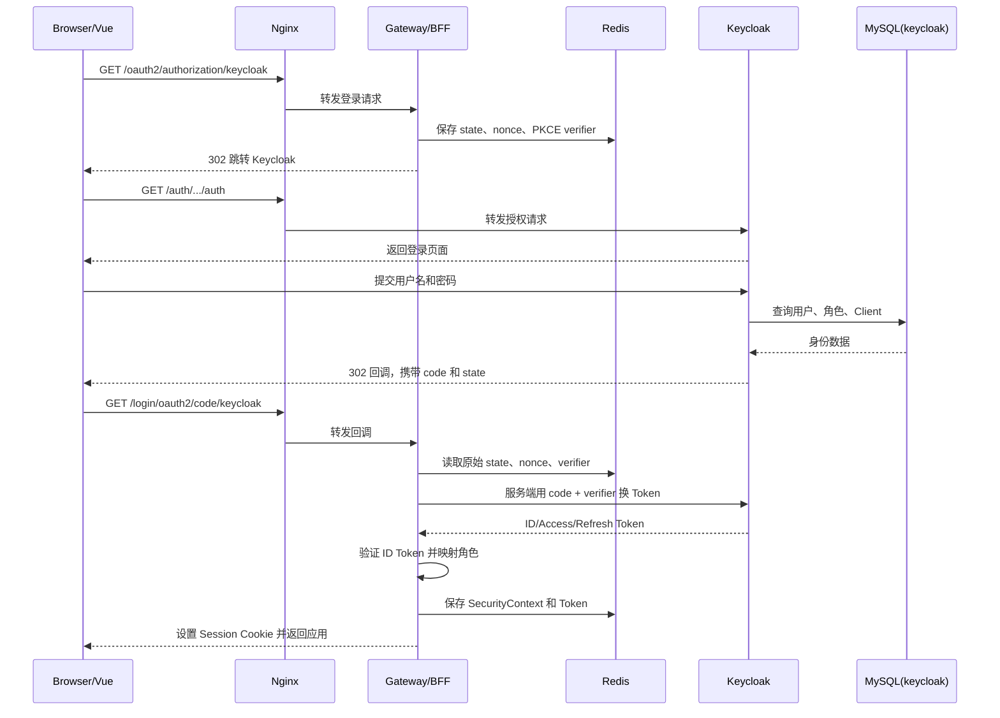
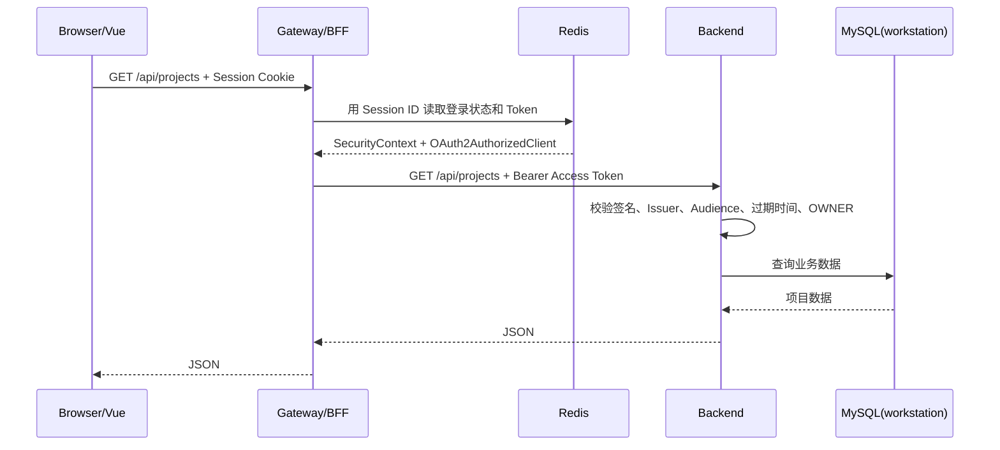
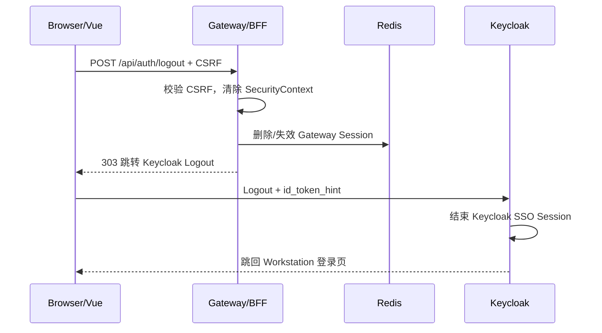

# Workstation 单点登录流程详解

## 1. 文档目的

本文从项目维护者的视角解释 Workstation 当前的 Keycloak + Gateway/BFF 登录方案，重点回答以下问题：

- 登录过程中有哪些组件？
- 每个组件负责什么？为什么需要它？
- OAuth2、OIDC、Realm、Client、Role、JWT 等概念分别是什么？
- 浏览器、Gateway、Keycloak、Redis、Backend 和 MySQL 之间的数据如何流动？
- 为什么不能只在 Gateway 判断“已经登录”，而 Backend 还要验证 Token？
- 哪些行为是项目代码规定的，哪些行为由 Spring 默认实现？

本文只讲认证与授权链路，不展开笔记、项目和任务等业务逻辑。

---

## 2. 一句话理解整体方案

```text
Keycloak 负责确认用户是谁，
Gateway/BFF 负责维护浏览器登录状态并代替浏览器携带 Token，
Backend 负责验证 Token 并判断用户能否访问业务 API。
```

完整结构如下：

```text
Browser / Vue
    |
    | Cookie、页面跳转、JSON 请求
    v
Web / Nginx
    |---------------- /auth/** --------------------> Keycloak
    |                                                  |
    |                                                  v
    |                                             MySQL(keycloak)
    |
    |---- /oauth2/**、/login/oauth2/**、/api/** ----> Gateway/BFF
                                                       |
                                                       | Session
                                                       v
                                                     Redis
                                                       |
                                                       | Authorization: Bearer <Access Token>
                                                       v
                                                    Backend
                                                       |
                                                       v
                                               MySQL(workstation)
```

浏览器不会保存 Access Token 和 Refresh Token。浏览器主要保存两类 Cookie：

- `WORKSTATION_SESSION`：Gateway Session ID，内容本身保存在 Redis。
- Keycloak 自己的 SSO Cookie：只发送给 `/auth` 路径，用于 Keycloak 判断用户是否已经在身份中心登录。

---

## 3. 认证、授权和单点登录

### 3.1 认证 Authentication

认证解决的问题是：

> 当前用户是谁？

例如，Keycloak 校验用户名和密码后确认当前用户是 `owner`，这就是认证。

### 3.2 授权 Authorization

授权解决的问题是：

> 这个用户是否有权执行当前操作？

例如，Backend 要求调用 `/api/**` 的用户必须拥有 `OWNER` 角色，这就是授权。

### 3.3 单点登录 SSO

单点登录解决的问题是：

> 用户登录一次身份中心后，访问其他受信任应用时是否还要再次输入密码？

Keycloak 保存自己的 SSO 会话。以后其他应用接入同一个 Keycloak Realm 时，浏览器跳转到 Keycloak，Keycloak发现用户已有有效会话，就可以直接签发新的登录结果，而不必再次询问密码。

当前 Workstation 只有一个应用，但采用的是可以扩展到多个应用的标准 SSO 流程。

---

## 4. OAuth2 和 OpenID Connect

### 4.1 OAuth2

OAuth2 主要是一套授权协议，用于让客户端取得 Access Token，并用它访问受保护资源。

OAuth2 本身关注的是：

```text
客户端是否有权访问资源
```

它本身并不完整定义“如何登录用户”和“用户信息采用什么标准格式”。

### 4.2 OpenID Connect

OpenID Connect，简称 OIDC，是构建在 OAuth2 之上的身份认证协议。

OIDC 在 OAuth2 的基础上增加了：

- ID Token
- 用户身份声明 Claims
- UserInfo 接口
- 标准登录和退出语义
- Issuer、Subject、Nonce 等身份校验规则

当前项目使用的是：

```text
OpenID Connect Authorization Code Flow + PKCE
```

### 4.3 为什么不自己实现登录协议

OIDC 登录涉及很多安全细节：

- 授权码必须只能使用一次。
- 回调必须校验 `state`，防止登录请求被替换。
- ID Token 必须验证签名、Issuer、Audience 和有效期。
- PKCE 必须校验授权请求和授权码兑换是否属于同一个客户端。
- 密钥需要支持轮换。
- Token 需要正确保存、刷新和撤销。

这些机制不适合由业务项目重新实现。当前项目只定义安全规则，底层协议由 Keycloak 和 Spring Security 实现。

---

## 5. OAuth2/OIDC 中的参与者

| 标准角色 | 本项目中的组件 | 作用 |
| --- | --- | --- |
| Resource Owner | Workstation 用户 | 数据和身份的拥有者 |
| User Agent | 浏览器 | 执行跳转、携带 Cookie、展示页面 |
| Client | Gateway/BFF | 发起 OIDC 登录、兑换并保存 Token |
| Authorization Server / OpenID Provider | Keycloak | 校验用户并签发 Token |
| Resource Server | Backend | 接收 Access Token，保护业务 API |
| Protected Resource | 笔记、项目、任务数据 | 只有授权用户可以访问的数据 |

这里最容易混淆的是 Client：

> OIDC 中的 Client 不是浏览器，也不是 Vue，而是 Gateway。

Gateway 拥有 `workstation-gateway` Client ID 和 Client Secret，所以它属于 confidential client，即能够安全保存 Client Secret 的服务端客户端。

---

## 6. 核心概念

### 6.1 Realm

Realm 是 Keycloak 中的一套独立身份空间。

一个 Realm 包含：

- 用户
- 密码策略
- 角色
- Client
- Token 签名密钥
- 登录会话
- 登录安全策略

当前 Realm 名称是：

```text
workstation
```

不同 Realm 之间的用户、角色和签名密钥相互隔离。

### 6.2 Client

Client 表示一个希望使用 Keycloak 登录的应用。

当前 Client 是：

```text
client_id = workstation-gateway
```

它规定：

- 允许使用 Authorization Code Flow。
- 不允许 Password Grant。
- 允许哪些登录回调地址。
- 允许哪些退出回跳地址。
- 使用哪个 Client Secret。
- Access Token 应包含哪个 Audience。

如果以后另一个系统接入 Keycloak，应该创建新的 Client，而不是与 Workstation 共用 Client Secret。

### 6.3 Role

Role 表示用户拥有的权限身份。

当前 Realm 定义了：

```text
OWNER
```

Keycloak 将它放入 Token 的 `realm_access.roles`：

```json
{
  "realm_access": {
    "roles": ["OWNER"]
  }
}
```

Gateway 和 Backend 会将其转换为 Spring Security 使用的：

```text
ROLE_OWNER
```

当前项目仍是单用户工作台，因此只有 Owner 角色。引入 Role 的目的不是立即实现复杂权限系统，而是让“身份认证”和“是否可以访问业务 API”成为两个独立判断。

### 6.4 Scope

Scope 表示客户端申请的授权范围。

当前 Gateway 申请：

```text
openid profile email
```

- `openid`：表示这是 OIDC 登录，而不只是普通 OAuth2 授权。
- `profile`：申请用户名等基础资料。
- `email`：申请邮箱相关资料。

### 6.5 Claim

Claim 是 Token 中的一个声明字段，例如：

| Claim | 含义 |
| --- | --- |
| `iss` | 谁签发了 Token，即 Issuer |
| `sub` | 用户在身份系统中的唯一 ID |
| `aud` | Token 是签发给谁使用的，即 Audience |
| `exp` | Token 什么时候过期 |
| `iat` | Token 什么时候签发 |
| `preferred_username` | 用户名 |
| `realm_access.roles` | Realm 角色 |

### 6.6 Authorization Code

Authorization Code 是 Keycloak 登录成功后发给 Gateway 的短期、一次性授权码。

它不是 Access Token，不能直接调用 Backend。Gateway 必须在服务端使用以下信息兑换 Token：

- Authorization Code
- Client ID
- Client Secret
- PKCE Code Verifier
- Redirect URI

授权码出现在浏览器回调中，但真正的 Token 只在 Gateway 与 Keycloak 的服务端通信中返回。

### 6.7 PKCE

PKCE 会为每一次授权请求生成一对临时值：

```text
code_verifier  -> 计算得到 -> code_challenge
```

流程是：

1. Gateway 保存 `code_verifier`。
2. Gateway 把 `code_challenge` 发给 Keycloak。
3. 登录回调后，Gateway 用 `code_verifier` 兑换 Token。
4. Keycloak 重新计算并比对 challenge。

即使攻击者截获 Authorization Code，没有对应的 `code_verifier` 也无法兑换 Token。

### 6.8 Token 的区别

| Token | 给谁使用 | 用途 |
| --- | --- | --- |
| ID Token | Gateway/OIDC Client | 证明本次登录用户是谁 |
| Access Token | Backend/Resource Server | 调用受保护业务 API |
| Refresh Token | Gateway/OAuth2 Client | Access Token 过期后申请新 Token |

这三种 Token 都不应作为 Workstation 的前端本地数据保存。

### 6.9 JWT

JWT 是一种可以携带 Claims 并进行数字签名的 Token 格式。

一个 JWT 通常由三部分组成：

```text
Header.Payload.Signature
```

JWT 的 Payload 可以被读取，所以不能把密码等机密数据放进去。它的安全性来自数字签名，而不是内容加密。

### 6.10 JWK

JWK 是描述签名公钥的标准格式。Keycloak 提供 JWK Set 接口，Backend 和 Gateway 从这里取得公钥。

用途是：

```text
Keycloak 用私钥签名 Token
Gateway/Backend 用公钥验证 Token
```

Gateway 和 Backend 不需要持有 Keycloak 私钥。

### 6.11 Issuer

Issuer 表示 Token 的签发者，对应 JWT 中的 `iss`。

当前值类似：

```text
http://localhost:8088/auth/realms/workstation
```

只验证签名还不够，因为同一套公钥配置或错误配置可能导致接受不属于当前 Realm 的 Token。因此还必须验证 Issuer。

### 6.12 Audience

Audience 表示 Access Token 的目标资源，对应 JWT 中的 `aud`。

当前 Backend 要求：

```text
aud = workstation-api
```

这样可以避免把签发给其他 API 的 Token 拿来调用 Workstation Backend。

### 6.13 Session

Gateway Session 表示浏览器在 Gateway 中的登录状态。

浏览器只保存 Session ID：

```http
Cookie: WORKSTATION_SESSION=<session-id>
```

Redis 保存 Session 的实际内容，例如：

- Spring SecurityContext
- 当前用户
- OAuth2 Client 信息
- Access Token
- Refresh Token
- 登录授权请求的临时状态
- Session 过期时间

具体 Redis Key、Hash 字段和序列化方式由 Spring Session 默认实现，项目没有自行规定。

### 6.14 CSRF

浏览器会自动携带 Cookie。因此恶意网站可能诱导浏览器向 Workstation 发出带 Session Cookie 的写请求，这就是 CSRF 风险。

防护方式是：

1. Gateway 生成随机 CSRF Token。
2. 前端调用 `/api/auth/csrf` 获取 Token。
3. 前端在写请求 Header 中携带 Token。
4. Gateway 比较 Session 中的 Token 与请求 Token。

恶意网站可以诱导浏览器携带 Cookie，但不能读取 Workstation 同源接口返回的 CSRF Token。

---

## 7. 每个组件的作用和引入原因

### 7.1 Vue

作用：

- 展示登录入口。
- 触发 OIDC 登录跳转。
- 查询当前用户。
- 在写请求中携带 CSRF Token。
- 收到 `401` 后返回登录页。

Vue 不负责：

- 收集用户名和密码。
- 保存 OAuth2 Token。
- 验证 JWT。
- 刷新 Token。

这样做是为了缩小浏览器中敏感凭据的暴露范围。

### 7.2 Nginx

作用：

- 提供 Vue 静态资源。
- 对外提供唯一同源入口。
- 将不同路径转发到 Gateway 或 Keycloak。
- 传递 Host、Proto 和 Port，保证 OIDC 回调地址正确。

路径分工：

| 浏览器路径 | 目标 |
| --- | --- |
| `/` | Vue |
| `/api/**` | Gateway |
| `/oauth2/**` | Gateway |
| `/login/oauth2/**` | Gateway |
| `/auth/**` | Keycloak |

引入 Nginx 后，浏览器不需要跨域访问多个端口，Cookie、CSRF 和 OIDC 回调更容易保持同源。

### 7.3 Keycloak

作用：

- 保存用户、密码和角色。
- 提供登录页面。
- 执行密码校验和登录安全策略。
- 管理 Realm、Client 和 SSO 会话。
- 签发 ID Token、Access Token 和 Refresh Token。
- 提供 JWK 公钥。
- 处理 OIDC Logout。

引入原因：

- 避免项目自行实现密码、Token、密钥轮换和 SSO。
- 后续其他应用可以复用同一个身份中心。
- 用户和认证协议从业务 Backend 中解耦。

### 7.4 Gateway/BFF

Gateway 同时承担两个角色。

作为 API Gateway：

- 匹配 `/api/**` 路由。
- 将请求转发给 Backend。
- 使用 Token Relay 添加 Access Token。

作为 Authentication BFF：

- 自己作为 OIDC Client 接入 Keycloak。
- 处理登录入口和回调。
- 在服务端保存 Token。
- 向浏览器提供 Session Cookie。
- 提供 `/api/auth/me` 和 `/api/auth/csrf`。
- 处理 CSRF 和全局退出。

引入原因：

- 避免 Vue 保存 Token。
- 将浏览器 Cookie 安全和后端 Bearer Token 安全连接起来。
- 把登录协议细节挡在前端之外。

当前 Gateway 是“认证型 BFF”，没有承担业务数据聚合和页面模型转换。

### 7.5 Spring Security OAuth2 Client

位于 Gateway 中，负责：

- 生成授权请求。
- 生成并校验 `state`、`nonce` 和 PKCE 参数。
- 处理回调。
- 用 Authorization Code 兑换 Token。
- 验证 ID Token。
- 创建登录后的 SecurityContext。
- 保存 OAuth2AuthorizedClient。

项目使用 Spring API 声明规则，不自行实现这些协议步骤。

### 7.6 Spring Session Redis

作用：

- 用 Redis 替换默认内存 WebSession。
- 保存和读取 Gateway Session。
- 管理 Session 过期。
- Gateway 重启后保留有效 Session。
- 为未来多 Gateway 实例提供共享 Session 基础。

项目只配置 Redis 地址、命名空间、Cookie 和超时时间。Redis 数据结构与序列化由 Spring Session 决定。

### 7.7 Redis

Redis 在当前架构中只保存 Gateway Session，不保存：

- 笔记
- 项目
- 用户密码
- Keycloak Realm
- Backend 业务数据

如果去掉 Redis，可以使用 JVM 内存 Session，但 Gateway 重启会让所有用户退出，也不适合部署多个 Gateway 实例。

### 7.8 Backend Resource Server

作用：

- 从 `Authorization` Header 读取 Bearer Token。
- 使用 Keycloak JWK 验证签名。
- 验证 Issuer、Audience 和有效期。
- 将 `realm_access.roles` 转换为 Spring Authority。
- 要求业务 API 必须拥有 `ROLE_OWNER`。

Backend 不负责：

- 用户输入密码登录。
- 创建浏览器 Session。
- 跳转 Keycloak。
- 保存 Refresh Token。
- 浏览器 CSRF。

它仍然验证 Token，是因为 Gateway 和 Backend 属于不同安全边界。即使某个请求绕过 Gateway进入内部网络，也不能在没有合法 Access Token 的情况下访问业务数据。

### 7.9 MySQL

同一个 MySQL 实例包含两个数据库：

```text
workstation：业务数据
keycloak：用户、Realm、Client、角色和 Keycloak 持久化会话
```

两个数据库使用独立账号。这样可以减少一个数据库组件，同时避免 Keycloak 直接拥有 Workstation 业务库权限。

---

## 8. 为什么这些组件要组合在一起

### 8.1 Keycloak + Gateway

Keycloak 擅长身份协议，但不应该承担 Workstation 业务 API 的反向代理。Gateway 擅长面向应用管理 Session 和请求，但不应该自行保存密码、签发 Token。

组合后：

```text
Keycloak 负责身份
Gateway 负责应用入口和浏览器会话
```

### 8.2 Gateway + Redis

Gateway 需要保存 SecurityContext 和 OAuth2 Token。把这些数据放在 Redis 后：

- 浏览器只持有随机 Session ID。
- Token 不进入前端存储。
- Gateway 重启不必立即让用户退出。
- 多实例可以读取同一份 Session。

### 8.3 Gateway + Backend Resource Server

Gateway 负责确认浏览器 Session，Backend 负责确认 Access Token。

这是两层不同的检查：

```text
Gateway：这个浏览器会话是否已经登录？
Backend：这个请求是否携带 Keycloak 签发、面向本 API 且拥有 OWNER 角色的 Token？
```

不能只让 Gateway 验证后就在内部添加一个普通用户名 Header，因为普通 Header 更容易被伪造，Backend 也无法独立验证请求来源。

### 8.4 Nginx + Gateway + Keycloak

OIDC 涉及浏览器跳转和 Cookie。通过 Nginx 使用统一外部地址后：

```text
应用地址     https://workstation.example.com/
Gateway 路径 https://workstation.example.com/oauth2/...
Keycloak路径 https://workstation.example.com/auth/...
```

这样可以降低跨域、Cookie Domain、回调地址和 HTTPS 配置的复杂度。

---

## 9. 标准登录流程与实际数据流

下面是最重要的完整流程。

### 阶段一：用户打开应用

```text
Browser -> GET /
Nginx   -> 返回 Vue 页面
Vue     -> GET /api/auth/me
```

如果浏览器还没有有效 `WORKSTATION_SESSION`：

```text
Gateway -> 401 UNAUTHENTICATED
Vue     -> 显示登录页面
```

### 阶段二：发起登录

用户点击“使用统一身份登录”：

```text
Browser -> GET /oauth2/authorization/keycloak
```

Spring Security 在 Gateway 中完成：

1. 找到 `keycloak` ClientRegistration。
2. 生成随机 `state`。
3. 生成 OIDC `nonce`。
4. 生成 PKCE `code_verifier` 和 `code_challenge`。
5. 把授权请求临时状态写入 Gateway Session。
6. Spring Session 将 Session 写入 Redis。
7. 返回 `302`，让浏览器跳转到 Keycloak。

重定向地址概念上类似：

```text
/auth/realms/workstation/protocol/openid-connect/auth
  ?client_id=workstation-gateway
  &response_type=code
  &scope=openid profile email
  &redirect_uri=.../login/oauth2/code/keycloak
  &state=<random>
  &nonce=<random>
  &code_challenge=<hash>
  &code_challenge_method=S256
```

### 阶段三：Keycloak 完成用户认证

```text
Browser -> Keycloak 登录页面
User    -> 输入用户名和密码
Keycloak -> 查询 MySQL(keycloak)
```

Keycloak 检查：

- 用户是否存在并启用。
- 密码是否正确。
- 是否触发暴力破解限制。
- 是否需要修改临时密码。
- Client 和 Redirect URI 是否允许。

成功后，Keycloak：

1. 创建或更新 Keycloak SSO 会话。
2. 给浏览器设置 Keycloak 自己的 SSO Cookie。
3. 生成一次性 Authorization Code。
4. 将浏览器重定向回 Gateway。

```text
GET /login/oauth2/code/keycloak
    ?code=<authorization-code>
    &state=<original-state>
```

此时浏览器仍然没有得到 Access Token。

### 阶段四：Gateway 处理回调并兑换 Token

Gateway 收到回调后，Spring Security：

1. 从 Redis Session 读取原始授权请求。
2. 比较回调中的 `state`。
3. 取出之前保存的 PKCE `code_verifier`。
4. 在服务端调用 Keycloak Token Endpoint。

服务端请求概念上类似：

```http
POST /auth/realms/workstation/protocol/openid-connect/token
Authorization: Basic <client-id-and-secret>
Content-Type: application/x-www-form-urlencoded

grant_type=authorization_code
code=<authorization-code>
redirect_uri=<same-redirect-uri>
code_verifier=<original-verifier>
```

Keycloak 校验成功后返回：

```json
{
  "id_token": "...",
  "access_token": "...",
  "refresh_token": "...",
  "expires_in": 300
}
```

Gateway 随后验证 ID Token：

- 使用 JWK 验证签名。
- `iss` 必须是 `workstation` Realm 的公开 Issuer。
- `aud` 必须包含 `workstation-gateway`。
- Token 必须未过期。
- `nonce` 必须与授权请求一致。

验证通过后：

1. 从 `realm_access.roles` 读取角色。
2. 将 `OWNER` 转换为 `ROLE_OWNER`。
3. 创建 Spring SecurityContext。
4. 保存 OAuth2AuthorizedClient 及 Token。
5. Spring Session 把这些信息保存到 Redis。
6. 浏览器得到 `WORKSTATION_SESSION` Cookie。
7. Gateway 将浏览器重定向到 `/login?login=success`。

### 登录时序图



---

## 10. 登录后的业务 API 流程

用户访问项目列表：

```http
GET /api/projects
Cookie: WORKSTATION_SESSION=<session-id>
```

数据流如下：

1. Nginx 将 `/api/projects` 转发给 Gateway。
2. Spring Session 根据 Cookie 中的 Session ID 查询 Redis。
3. Spring Security 恢复当前登录用户和 OAuth2AuthorizedClient。
4. Gateway 路由匹配 `Path=/api/**`。
5. `TokenRelay` 从 Session 中取得 Access Token。
6. Gateway 给转发请求添加 Bearer Token。
7. Backend 验证 JWT。
8. Backend 确认存在 `ROLE_OWNER`。
9. Controller、Service、Mapper 查询 MySQL 业务库。
10. 响应沿原路径返回浏览器。

Gateway 转发给 Backend 的请求类似：

```http
GET /api/projects
Authorization: Bearer eyJ...
```

业务请求时序图：



### Gateway 路由在哪里

Gateway 路由位于：

```text
gateway/src/main/resources/application.yaml
```

核心配置：

```yaml
routes:
  - id: workstation-backend
    uri: ${BACKEND_BASE_URL:http://localhost:8080}
    predicates:
      - Path=/api/**
    filters:
      - SaveSession
      - TokenRelay
```

- `Path=/api/**`：决定哪些请求交给 Backend。
- `SaveSession`：转发前确保当前 WebSession 已保存。
- `TokenRelay`：将当前 OAuth2 Access Token放入下游 Authorization Header。

`/api/auth/me` 和 `/api/auth/csrf` 虽然也符合 `/api/**`，但它们有 Gateway 本地 Controller，因此由 Gateway 本地处理。`/api/auth/logout` 在 Spring Security Filter 中处理。其他业务 API 才会被路由到 Backend。

---

## 11. 写请求与 CSRF 流程

以创建项目为例。

### 获取 CSRF Token

```text
Vue -> GET /api/auth/csrf -> Gateway
```

响应类似：

```json
{
  "headerName": "X-XSRF-TOKEN",
  "parameterName": "_csrf",
  "token": "<random-token>"
}
```

### 发出写请求

```http
POST /api/projects
Cookie: WORKSTATION_SESSION=<session-id>
X-XSRF-TOKEN: <random-token>
Content-Type: application/json
```

Gateway 先校验 CSRF：

- Cookie/Session 有效，但没有 CSRF Header：返回 `403`。
- CSRF Token 不匹配：返回 `403`。
- 校验通过：继续 Token Relay 并调用 Backend。

Backend 不再次校验浏览器 CSRF，因为 Backend 不使用浏览器 Cookie，只接受 Authorization Bearer Token。

---

## 12. 退出流程

退出不是简单删除前端变量，而是结束两层会话：

```text
Gateway 应用 Session
Keycloak SSO Session
```

流程如下：

1. Vue 获取 CSRF Token。
2. Vue 使用原生 POST 表单提交 `/api/auth/logout`。
3. Gateway 校验 CSRF。
4. Spring Security 清除 SecurityContext 和 Gateway Session。
5. Spring Session 删除或失效 Redis 中的 Session。
6. Gateway 生成 Keycloak Logout 地址。
7. Gateway 携带 `id_token_hint` 将浏览器重定向到 Keycloak。
8. Keycloak 结束 SSO Session。
9. Keycloak 将浏览器重定向回 `/login?logout=success`。



如果只清除 Gateway Session、不退出 Keycloak，用户再次点击登录时可能因为 Keycloak SSO Cookie 仍有效而直接登录，这不属于完整退出。

---

## 13. 失败场景

### 13.1 未登录访问业务 API

```text
Browser -> Gateway
Gateway 找不到有效 Session
Gateway -> 401 UNAUTHENTICATED
```

请求不会到达 Backend。

### 13.2 Token 无效或过期

```text
Gateway -> Backend，携带无效 Token
Backend JWT 校验失败
Backend -> 401 UNAUTHENTICATED
```

### 13.3 Token 没有 OWNER

```text
Backend 验证 Token 合法
Backend 发现没有 ROLE_OWNER
Backend -> 403 ACCESS_DENIED
```

`401` 和 `403` 的区别：

- `401`：没有可接受的身份凭据。
- `403`：身份凭据有效，但权限不足。

### 13.4 写请求没有 CSRF Token

```text
Browser -> Gateway，携带 Session Cookie，但没有正确 CSRF Header
Gateway -> 403
```

### 13.5 Redis 不可用

Gateway 无法读取和保存 Session：

- 新登录无法稳定完成。
- 已登录请求无法恢复 SecurityContext。
- Token Relay 无法取得 Token。

Backend 和 Keycloak虽然可能仍在运行，但浏览器登录链路不可用。

### 13.6 Keycloak 不可用

- 无法发起新登录。
- 无法用授权码兑换 Token。
- 无法刷新或退出 Keycloak SSO。
- 已经在 Gateway 中建立的短期 Session 是否还能调用 Backend，取决于当前 Access Token 是否仍然有效。

---

## 14. 哪些是项目实现，哪些是 Spring 默认实现

### 项目明确规定的内容

- 使用哪个 Keycloak Realm 和 Client。
- 哪些路径允许匿名访问。
- `/api/**` 必须登录。
- Backend 业务 API 必须有 `OWNER` 角色。
- Issuer 和 Audience 的期望值。
- 登录成功和退出成功回到哪里。
- Keycloak 角色如何转换为 Spring Authority。
- Redis 地址、Session 命名空间和过期时间。
- Nginx 和 Gateway 的路由规则。
- `/api/auth/me` 与 `/api/auth/csrf` 的响应结构。

### Spring/Keycloak 默认实现的内容

- OIDC 授权请求和回调解析。
- `state`、`nonce`、PKCE 的生成与验证。
- Authorization Code 兑换 Token。
- SecurityContext 的创建和恢复。
- OAuth2AuthorizedClient 的保存。
- Spring Session 写入 Redis。
- Redis Session 的 Key、字段、序列化和过期处理。
- Token Relay。
- JWT 解析和 JWK 公钥选择。
- Keycloak 密码校验、Token 签名和密钥管理。

因此，这套代码的主要工作是：

```text
配置标准组件 + 声明项目安全策略 + 连接不同安全边界
```

而不是重新实现 OAuth2、OIDC、JWT 或 Session 存储算法。

---

## 15. 为什么不采用其他方案

### 15.1 Vue 直接连接 Keycloak

这种方案通常需要 Vue 持有 Access Token，并主动添加 Authorization Header。

没有采用的主要原因：

- Token 进入浏览器运行环境，XSS 后果更严重。
- 前端需要理解 Token 生命周期和刷新。
- 登录协议细节与 Vue 耦合。

### 15.2 继续由 Backend 处理用户名和密码

问题是：

- Backend 同时承担业务和身份服务。
- 很难自然扩展成多个应用共享登录。
- 密码策略、MFA、第三方身份源等能力都需要自行维护。

### 15.3 只在 Gateway 验证，Backend 完全信任内网

问题是：

- 一旦内部网络存在绕过路径，Backend 没有第二道身份检查。
- 普通用户 Header 容易被伪造。
- 服务边界不清晰。

所以 Backend 仍作为 Resource Server 验证 JWT。

### 15.4 Gateway 使用本机内存 Session

可以减少 Redis，但会造成：

- Gateway 重启后全部退出。
- 无法直接部署多个 Gateway 实例。
- 登录状态与单台进程绑定。

当前保留 Redis，是用一个较轻的组件换取稳定的服务端 Session。

---

## 16. 代码位置对照

| 内容 | 文件 |
| --- | --- |
| Gateway 安全规则 | `gateway/src/main/java/com/mike/workstation/gateway/SecurityConfig.java` |
| 当前用户与 CSRF 接口 | `gateway/src/main/java/com/mike/workstation/gateway/AuthController.java` |
| Gateway SSO 参数 | `gateway/src/main/java/com/mike/workstation/gateway/GatewaySsoProperties.java` |
| Gateway 路由与 Redis Session | `gateway/src/main/resources/application.yaml` |
| Backend JWT 校验 | `backend/src/main/java/com/mike/workstation/config/SecurityConfig.java` |
| Backend Issuer/Audience 配置 | `backend/src/main/java/com/mike/workstation/config/ResourceServerProperties.java` |
| Keycloak Realm/Client/Role | `keycloak/workstation-realm.json` |
| 前端登录和退出 | `frontend/src/api/workstation.ts` |
| 前端 Cookie、CSRF、API Client | `frontend/src/api/client.ts` |
| Nginx 同源代理 | `frontend/nginx.conf` |
| 容器组合 | `compose.yaml`、`compose.prod.yaml` |
| Keycloak MySQL 初始化 | `backend/src/main/resources/db/init-keycloak-database.sh` |

---

## 17. 推荐阅读代码的顺序

不要先从完整 `SecurityConfig` 的每一个 API 开始。推荐顺序是：

1. 阅读 `frontend/src/api/workstation.ts`，确认登录和退出从哪里发起。
2. 阅读 Gateway `AuthController`，理解前端真正直接使用的两个 BFF 接口。
3. 阅读 `application.yaml` 的 `/api/**` 路由和 `TokenRelay`。
4. 阅读 Gateway `SecurityConfig` 的 `authorizeExchange`。
5. 阅读 `oauth2Login`、PKCE 和 ClientRegistration。
6. 阅读 Gateway 的角色映射与 Logout Handler。
7. 最后阅读 Backend `SecurityConfig` 的 JWT 校验和 `OWNER` 授权。

每一步只回答一个问题：

```text
请求从哪里来？
当前组件检查什么？
检查通过后交给谁？
```

---

## 18. 最终总结

当前认证架构可以归纳为四层：

```text
第一层：Keycloak 验证用户名和密码，签发标准 Token
第二层：Gateway 用 Redis Session 隔离浏览器和 OAuth2 Token
第三层：Gateway 用 Token Relay 代表浏览器调用 Backend
第四层：Backend 独立验证 JWT 和 OWNER 权限后执行业务
```

各组件组合的核心原因是职责分离：

- Keycloak 不处理 Workstation 业务。
- Gateway 不保存用户密码，也不执行业务查询。
- Backend 不处理浏览器登录和 Session。
- Vue 不保存 OAuth2 Token。
- Redis 不保存业务数据，只保存 Gateway Session。
- MySQL 用分库和独立账号隔离业务数据与身份数据。

这套方案增加了一些组件和标准概念，但换来的能力是：标准化登录、Token 不进入前端、Backend 保留独立安全边界，以及未来其他应用可以接入同一个身份中心。

---

## 19. 标准与官方资料

- [OAuth 2.0 RFC 6749](https://www.rfc-editor.org/rfc/rfc6749)
- [PKCE RFC 7636](https://www.rfc-editor.org/rfc/rfc7636)
- [JWT RFC 7519](https://www.rfc-editor.org/rfc/rfc7519)
- [OpenID Connect Core](https://openid.net/specs/openid-connect-core-1_0.html)
- [Keycloak OIDC 文档](https://www.keycloak.org/securing-apps/oidc-layers)
- [Spring Security Reactive OAuth2 Client](https://docs.spring.io/spring-security/reference/reactive/oauth2/index.html)
- [Spring Security Resource Server JWT](https://docs.spring.io/spring-security/reference/servlet/oauth2/resource-server/jwt.html)
- [Spring Session](https://docs.spring.io/spring-session/reference/)
- [Spring Cloud Gateway Token Relay](https://docs.spring.io/spring-cloud-gateway/reference/spring-cloud-gateway-server-webflux/gatewayfilter-factories/tokenrelay-filter-factory.html)
